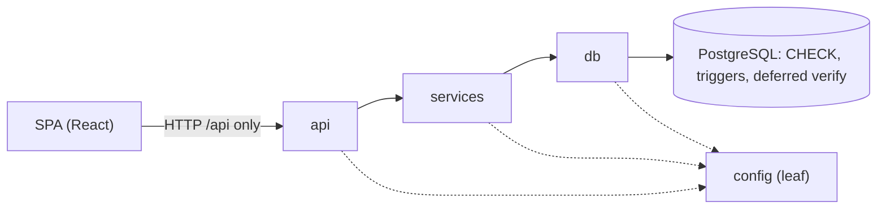
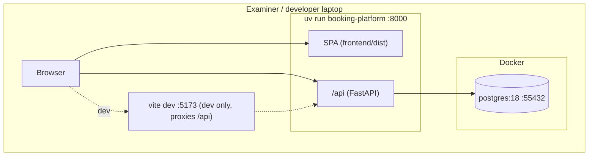
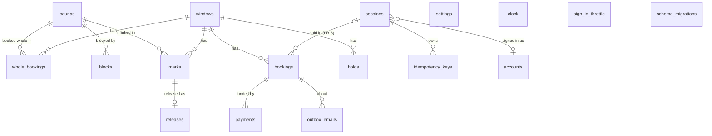

# Architecture Spine: Saunalöyly Booking Platform

## Design Paradigm

**Layered, around a database-enforced invariant kernel.** Three backend layers with one direction of dependency, and PostgreSQL as the final word on capacity. The browser runs a React SPA that knows the platform only through the HTTP API.

| Layer | Lives in | Owns |
| --- | --- | --- |
| SPA | `frontend/` | Pages, page copy, UX checks (never authoritative) |
| api | `src/booking_platform/api/` | HTTP: routing, Pydantic shape validation, role check, the code → status table |
| services | `src/booking_platform/services/` | Application rules, one transaction per user action, email text, catch-up |
| db | `src/booking_platform/db/` + `migrations/` | All SQL, pool, `run()` with retry, `lock_windows()`, translating store refusals; the schema enforces capacity and Placement |
| config | `src/booking_platform/config.py` | Leaf module: deployment settings and test switches; importable by every layer |



## Invariants & Rules

### AD-1: Dependencies point one way, and so do refusals [ADOPTED]

- **Binds:** all backend code
- **Prevents:** rules scattered across routes, SQL in routes, and each story inventing its own error class and constraint mapping.
- **Rule:** `api` imports `services`, `services` imports `db`, and all three may import `config`. `db` imports nothing above it. SQL text appears only in `db/` and `migrations/`. `api` holds no business rule and never opens a connection. Every refusal is one exception type, `services.errors.Refused(code, **facts)`:
  - `services` raises it;
  - `db` translates store errors into it by constraint name;
  - `api/errors.py` maps codes to HTTP status (AD-16).

### AD-2: The store is the last word on capacity [ADOPTED]

- **Binds:** FR-10, FR-11, FR-12, FR-29, FR-31, FR-32, FR-35, FR-40, FR-41; every table that changes Seat capacity, Seats booked or Seats held
- **Prevents:** a capacity rule that holds only when the application is used correctly.
- **Rule:** capacity and Placement rules are enforced in PostgreSQL by:
  - the counters `windows.seat_capacity`, `booked` and `held`;
  - `CHECK booked_within_capacity`;
  - the recompute triggers;
  - the deferred `verify_window`.

  Any new table or column that changes these numbers gets the same parts: a BEFORE trigger that locks the Window, an AFTER trigger that recomputes, inclusion in `verify_window`, a bypass test that writes around the API, and an entry in the test harness's `MUTATIONS`. Python may check the same rule first to give a better message, but never instead of the store. Rules that do not touch capacity (Booking horizon, Booking deadline, Cutoff, throttle, one-time keys) are decided and refused in `services`. The SQL helpers that compute them and the defensive CHECKs already in `0001` stay, and more may be added.

### AD-3: One user action = one transaction, Windows locked first [ADOPTED]

- **Binds:** every state-changing service action
- **Prevents:** partial writes (FR-14 "nothing written"), deadlocks from inconsistent lock order, and refusals that roll back the record they must keep.
- **Rule:** each action runs inside exactly one `db.run(work)`.
  - **Locking:** an action that reads before it writes, or writes more than one statement, calls `db.lock_windows(c, ids)` with every Window it can touch before its first write. Several Windows are locked in id order inside that function. A single-statement write may rely on the BEFORE lock triggers.
  - **Scope:** everything the action produces is written in that transaction: Booking, payment record, Outbox email, one-time-key outcome and session change.
  - **Refusals:** a refusal that must keep a record (a sign-in failure, for example) is returned from `work`, so the transaction commits, and is raised after `db.run` returns. Only refusals that write nothing are raised inside `work`.
  - **Waits:** no Window lock is held across a wait: network calls, sleeps, password hashing, or anything outside the process.
  - **Retry:** temporary conflicts (40001, 40P01) are retried only by `db.run`. The only retry inside services is the Booking-reference claim (AD-20).

### AD-4: Time comes from the store; Venue rules live in `settings`; reads never write [ADOPTED]

- **Binds:** NFR-3, NFR-11, FR-13, FR-21, FR-39; Booking horizon, Booking deadline, Cutoff, Hold expiry, Release time, throttle, session expiry, retention, remedy limit
- **Prevents:** a rule judged on two clocks or with two different edges, a value hard-coded in three places, and GET requests that take Window locks.
- **Rule:**
  - **Clock:** every time rule reads `app_now()` inside the transaction, after the lock. Python never uses `datetime.now()` for a rule, and the SPA never uses the browser clock for one.
  - **Values:** every Venue rule value (Booking horizon, Booking deadline, Cutoffs, Release time, `venue_tz`) is a column of the `settings` row, with the PRD default. The Booking horizon is added in the Core.
  - **Predicates:** each time-rule predicate is one SQL function (`booking_deadline(wid)`, `within_horizon(wid)`, `venue_date(wid)` …). The listing and the action both call it.
  - **Venue dates:** a cast of a `timestamptz` to `date` or `time` without `AT TIME ZONE settings.venue_tz` is forbidden. The pool sets `TimeZone = 'UTC'`.
  - **No jobs:** there are no background jobs or timers. A due effect is evaluated as a condition when it is read. For example, the booking list masks a Guest who is past retention.
  - **Catch-up:** effects are materialised only at startup or by a write that touches the row, through one function per effect in `services/catchup.py`.
  - **Reads never write:** GET endpoints never write, with one exception. `windows.ensure_generated()` runs before Window listings: it inserts only new Windows, after the stored high-water mark `settings.windows_generated_through`, and under an advisory lock.
  - **Test clock:** tests move the clock only by writing `clock.off` directly.

### AD-5: Seats left is read from the rows [ADOPTED]

- **Binds:** FR-3, FR-12, FR-16, FR-35
- **Prevents:** the Guest and Administrator lists showing different numbers, and a stale counter hiding a release or an expired Hold.
- **Rule:** every Seats left, Seats booked and Seat capacity shown anywhere comes from the SQL functions `seats_left()`, `window_booked_seats()` and `window_open_capacity()`. It never comes from the stored counters, and it is never computed in Python or in the SPA.

### AD-6: Placement is derived, never stored [ADOPTED]

- **Binds:** FR-4, FR-29, FR-31, FR-40, FR-41
- **Prevents:** Seats tied to a Sauna, which would turn Whole-sauna bookings, Blocks and Fill-order changes into rewrites.
- **Rule:** a Sauna reference exists only on Whole-sauna bookings, Blocks and Whole-booking-only marks. A Booking carries a Window and a Seat count, never a Sauna. Placement is computed when it is read. A nullable "placed in Sauna" column is added only if one-Sauna access (Vision) is built.

### AD-7: Bookings are never deleted [ADOPTED]

- **Binds:** FR-16, FR-26, FR-40, FR-42
- **Prevents:** a cancellation path that deletes rows, which loses history and breaks the Overbooking fallback.
- **Rule:** migration `0002` makes these changes:
  - it adds `bookings.status` (`active` | `cancelled`);
  - it adds `entry_time` (default `app_now()`; kept apart from `created_at`, the time of booking);
  - it makes `window_booked_seats()` count only active rows;
  - it restricts the `bookings` triggers to `INSERT`, `DELETE` and `UPDATE OF window_id, seats, status`.

  A cancellation sets the status in the same transaction as its cause. A Change is a history row (from If-time 2), never a third status. A Block that would leave too little capacity first makes room in its own transaction (FR-40 D3 order) and then inserts the Block. The store keeps refusing an over-capacity Block.

### AD-8: Sessions are server-side rows with hashed tokens [ADOPTED]

- **Binds:** FR-8, FR-15, FR-20, FR-35, FR-37; later Manage-link and remedy tokens (FR-25, FR-42)
- **Prevents:** a sign-out that does not revoke, client-chosen identities, lost-response double bookings, and each feature inventing its own token storage.
- **Rule:**
  - **Storage:** one `sessions` table holds anonymous and signed-in browsers, with a role per row. The cookie holds a 256-bit random token: HttpOnly, `SameSite=Strict`, `Path=/`, and `Secure` once HTTPS is on. The store keeps only the SHA-256 hash of the token.
  - **References:** everything references `sessions.id`. The foreign keys from `bookings` and `holds` are `ON DELETE SET NULL`, and the one from `idempotency_keys` is `CASCADE`. The slice's client-supplied `session_id` is replaced.
  - **Creation:** the SPA calls `POST /api/session` when it loads. That call creates an anonymous session, or returns the existing one if it is still valid. A Guest write without a session gets `401 no_session`.
  - **Lifetimes:** anonymous sessions last 24 h and Administrator sessions 8 h, both sliding.
  - **Sign-in and sign-out:** sign-in rotates the token on the same row and sets its role, so the row id never changes. Sign-out deletes the row. Expired rows are purged at startup.
  - **CSRF:** every state-changing request must be same-origin and carry a JSON body. There are no CSRF tokens.
  - **Later tokens:** every later bearer token has at least 128 random bits, only its hash is stored, and an invalid token gets the same response as an unknown one.

### AD-9: Repeated submits return the first outcome [ADOPTED]

- **Binds:** FR-6, FR-7, FR-25 (later confirming actions)
- **Prevents:** a double click creating two Bookings or charges, a paying Guest seeing an error, and a failed payment that can never be retried.
- **Rule:** the SPA creates a UUID when the Guest reaches the review page and sends it as `Idempotency-Key`. It reuses the same key for every retry until the booking is paid. The key lives with the booking draft in `sessionStorage`, so a reload in the same tab keeps it. After `409 invalid_key` the SPA never makes a new key on its own.
  - **Table:** `idempotency_keys(key UNIQUE, session_id, booking_id)` holds ids only, never personal data.
  - **Order:** the key is read as the first statement after `lock_windows`.
  - **Repeats:** a known key from the same session rebuilds the original response from the Booking and writes nothing. A key from another session is refused with `409 invalid_key`.
  - **What is stored:** only a success is stored. A refusal or a failed payment stores nothing, so the retry runs again.

### AD-10: Administrator access is decided at the router [ADOPTED]

- **Binds:** FR-16, FR-17, FR-20, IV-7, RB-1 to RB-4
- **Prevents:** an Administrator endpoint that someone forgot to protect, and API typos that answer with the SPA.
- **Rule:** every Administrator endpoint is under `/api/admin/`, on one router whose dependency requires an Administrator session.
  - Anonymous callers get 401, and non-Administrators get 403. Neither changes anything.
  - Asking for something that is not the caller's answers exactly like something that does not exist (404).
  - Any unknown `/api/*` path returns the JSON 404 envelope and never the SPA.
  - `/health` becomes `/api/health`.

### AD-11: Sign-in is throttled per email, serialised in the store [ADOPTED]

- **Binds:** FR-15, FR-19, FR-37, PW-1 to PW-6
- **Prevents:** a throttle that resets on restart, reveals whether an account exists, or lets parallel guesses slip through.
- **Rule:**
  - **Throttle table:** `sign_in_throttle(email_lower PRIMARY KEY, failures, locked_until)`, with no foreign key to accounts.
  - **Order:** each sign-in first upserts and locks its row (`FOR UPDATE`), then decides. Thresholds follow FR-15.
  - **Refusals:** a refusal is the same 401 and message as a wrong password, and it is recorded by returning it from `work` (AD-3).
  - **Passwords:** Argon2id, with the `argon2-cffi` defaults in PHC format, rehashed at sign-in when the parameters change.
  - **Password rules:** FR-19 is checked in one service function, used by the seed, `create-admin` and later sign-up. The common-password list is a data file in the package.

### AD-12: Email is written only through the Outbox service [ADOPTED]

- **Binds:** FR-1, FR-5, FR-8, FR-17, FR-21, every email in PRD §7
- **Prevents:** emails sent outside the action's transaction, a confirmation page that cannot find its email, and terms or links that drift between page and email.
- **Rule:**
  - **Sending:** `services.outbox.send(c, to, subject, body, *, booking_id=None)` is the only sender. It is called inside the action's transaction and returns the email id.
  - **Format:** bodies are plain English text, built in `services`.
  - **Links:** links are absolute, built from the configured base URL. Paths and anchors are constants in `config.links`.
  - **Shared text:** text that appears both on a page and in an email (the booking terms, "what happens next") lives once in `content/`, and both the SPA build and `services` read it from there.
  - **UI word:** all text that people read, in `content/`, email bodies and the SPA, says "session" for a Window (PRD §3). Code, API fields and the store keep Window.
  - **Guest read:** the only Guest-facing Outbox read is `GET /api/bookings/{reference}/confirmation`. It is checked against the paying session (404 otherwise) and returns the Booking facts plus the stored email. The SPA route is `/confirmation/:reference`.
  - **Administrator read:** only the Administrator API lists the Outbox.
  - **Retention:** retention clears the recipient and body of emails linked to an anonymised Booking.

### AD-13: Payment is one synchronous function in the same transaction [ADOPTED]

- **Binds:** FR-6, FR-7, FR-28, FR-36, NFR-4
- **Prevents:** a charge without a Booking, a Booking without a charge, two different "total paid" figures, and floating-point money.
- **Rule:**
  - **Money:** amounts are an integer number of øre (NOK including VAT) everywhere.
  - **Booking value:** `bookings.total_ore` and `price_per_seat_ore` are the Booking's value. They are what every page and email shows, and they are never recomputed.
  - **Payments:** `payments` rows (1..n per Booking) record how the value was funded, one row per part. Only refunds and the audit read them.
  - **Charging:** `services.payment.charge()` decides its outcome before `lock_windows` and writes its row after the lock, in the same transaction.

### AD-14: Test switches are a startup file read at fixed seams [ADOPTED]

- **Binds:** FR-7, FR-14, FR-36, FR-49, the Test switch in the glossary
- **Prevents:** switches reachable through the API, test hooks scattered through the code, and switches that block startup.
- **Rule:** `config/test-switches.toml` is git-ignored, and `config/test-switches.example.toml` (all switches off) is committed. The file is read once at startup into a frozen object in `config`. Switches are read only at named seams:
  - `payment.charge`: `payment = "ok" | "fail" | "hold"`. With `hold`, the charge raises before anything is written, and the action returns `409 payment_pending`. The test then moves the clock and resubmits with the same key.
  - `db.run`: `force_conflict` raises a real rollback after `work` has written. It applies only to runs made for an HTTP request, never to migrations, seeding or startup catch-up.
  - Later, the lock simulator.

  No endpoint reads or changes a switch. The trigger-based FR-14 test that produces a real 40001 stays alongside.

### AD-15: The schema changes only through numbered SQL migrations [ADOPTED]

- **Binds:** `migrations/`, DR-4
- **Prevents:** conflicting schema edits, skipped migrations, migrations that hold reference data, and a database that cannot be reproduced.
- **Rule:**
  - **Files:** migrations are plain SQL files named `migrations/NNNN_short_name.sql`. They create structure and singleton rows only, never reference values (AD-18).
  - **Runner:** the runner applies them in order at startup and at the start of the test run. It records full file names in `schema_migrations` and refuses to start if two files share a number.
  - **Existing databases:** a database that has `windows` but no `schema_migrations` counts as having `0001` applied.
  - **Numbering:** a story takes its number when it merges, not when it starts.
  - **Changes:** a merged migration is never edited.
  - **0001:** `0001` is the slice's `schema.sql`, moved unchanged.

### AD-16: The server returns codes and facts; the SPA owns page copy [ADOPTED]

- **Binds:** FR-2, FR-3, FR-11, FR-12, FR-14, FR-18, FR-22, NFR-5, NFR-9
- **Prevents:** one refusal with two codes or two statuses, and the same refusal worded differently on different pages.
- **Rule:**
  - **Code table:** every refusal code is declared once in `api/errors.py`, with its status and facts, and the SPA mirrors that table. The table starts with the slice's codes.
  - **Refusals on Review:** `no_seat_free` carries `seats_left`. At 0 the SPA says "No seat free", and above 0 it states the true number. A Window past its Booking deadline is refused with `deadline_passed`.
  - **Time facts:** the SPA may not use the browser clock (AD-4), so listings send what the pages show. Each Window carries `already_started`, and each listing carries `horizon_end` (a Venue date) and `horizon_days`. All three come from the AD-4 predicates and `settings`, and the SPA never computes them.
  - **Status codes:** 422 is used only for shape errors from Pydantic. Every rule judged against the store or the clock (horizon, deadline, capacity, Cutoff) is a 409 from `services` after the lock.
  - **Envelope:** refusals use the envelope from the Conventions. Its `message` is optional, is meant for developers, and never contains store text.
  - **Success bodies:** successful responses are bare JSON objects.
  - **Copy:** page copy lives in the SPA, email copy in `services`, and copy used by both in `content/` (AD-12).
  - **Venue facts:** facts about the Venue that pages show (Saunas, prices, Window schedule, contact) come from the API, never hard-coded in the SPA.

### AD-17: The SPA reaches the server through one client module [ADOPTED]

- **Binds:** all of `frontend/`
- **Prevents:** idempotency keys, error handling or credentials handled differently from page to page.
- **Rule:** `frontend/src/api.js` is the only module that calls `fetch`.
  - It uses relative `/api/…` URLs and same-origin cookies.
  - It sets `Idempotency-Key` (AD-9) and turns the error envelope into one error type.
  - No page talks to any other origin (FR-21).
  - Routing uses `react-router` in Data mode (`createBrowserRouter`), never `react-router-dom` or framework mode.

### AD-18: Reference data comes from `seeds/`, applied idempotently at every start [ADOPTED]

- **Binds:** FR-13, FR-15, NFR-1, NFR-10, DR-2, DR-5
- **Prevents:** a fresh clone with no bookable dates, duplicate Windows or sample Bookings on restart, reference values held in migrations, and a restart that undoes an Administrator change.
- **Rule:** after migrations, startup applies `seeds/` in every environment:
  - **Contents:** Saunas, Capacities, Fill order, prices, Setting values, the Window schedule, the Administrator and the sample Bookings.
  - **Writes:** the seed writes a value only where the row is absent. After the first start, the store owns the value. A new reference column gets the seed value as its default in the same change.
  - **Windows:** Windows are generated by `windows.ensure_generated()` (AD-4), counting from the Venue date of `app_now()`.
  - **Sample Bookings:** they are created through `services.booking.create`, under one fixed seed session and fixed idempotency keys, so a rerun is a no-op.
  - **Validation:** the seed goes through the same validation as Administrator input (IV-6).
  - **Administrator:** the seeded Administrator's credentials are documented in the README. Other Administrators are created only by `uv run booking-platform create-admin`.

### AD-19: Nothing secret is logged [ADOPTED]

- **Binds:** FR-19, FR-21
- **Prevents:** passwords, session tokens, Manage-link tokens or Door codes ending up in logs.
- **Rule:** request bodies, headers and cookies are never logged. Log lines name ids and error codes only.

### AD-20: One way to create a Booking reference [ADOPTED]

- **Binds:** FR-8, FR-16, FR-26, AD-18
- **Prevents:** reference retries that abort the transaction or swallow a capacity refusal.
- **Rule:** a reference is 8 characters of upper-case Crockford base32. `services.reference` inserts the Booking with `ON CONFLICT (reference) DO NOTHING RETURNING id` and tries a new candidate at most 5 times. It raises no exception and uses no savepoint. Every Booking creator uses it: the Guest flow, the seed and a split.

### AD-21: The slice is reshaped, never loosened [ADOPTED]

- **Binds:** the first skeleton story; `tests/`
- **Prevents:** the FR-10 proof turning red and being "fixed" by weakening a rule.
- **Rule:** the first skeleton story moves the slice to this spine:
  - the `/api` paths;
  - the router-level Administrator access;
  - server sessions;
  - Seats 1–10;
  - the migration runner.

  The slice's tests are kept as regression proof. They sign in through a test fixture and fill Windows with several Bookings of at most 10 Seats each, or with raw inserts. No rule is loosened to keep a slice test green.

### AD-22: Deployment configuration comes from `BP_*` environment variables [ADOPTED]

- **Binds:** NFR-1, DR-5, FR-24
- **Prevents:** deployment values spread through the code, and Venue rules split between Python and the store.
- **Rule:** `config.py` is the only reader of the `BP_*` environment variables:
  - the database URL;
  - the base URL;
  - HTTPS on or off;
  - host and port;
  - the test variables already in use.

  Each variable has a working local default, so no file is needed. Venue rules never live there (AD-4). The platform runs as one uvicorn process, without `--workers`.

## Consistency Conventions

| Concern | Convention |
| --- | --- |
| Naming | PRD glossary terms in English. Tables are plural snake_case; columns, JSON fields and Python names are snake_case. API paths are lower-case plural nouns under `/api/`. React components use PascalCase files in `frontend/src/pages/` and `frontend/src/components/`. |
| Ids | Internal ids are integers and are never shown to Guests. The Booking reference is the only Guest-facing id (AD-20). |
| Time | Columns are `timestamptz`. The API sends ISO 8601 with an offset; a Venue date is `YYYY-MM-DD`. `venue_tz` is fixed to `Europe/Oslo` in v1, and the SPA formats with `Intl.DateTimeFormat` in that zone. |
| Money | Integer øre in every field ending in `_ore`. The SPA formats it as "NOK 500". |
| Error envelope | `{"detail": {"error": "<code>", "message"?: "<dev text>", …facts}}`, ratified from the slice. 401 not signed in, sign-in refused or no session; 403 not allowed; 404 unknown or not yours; 409 rule refused; 422 shape (`invalid_input` with `fields`); 503 `try_again`. |
| Input | Pydantic models use `extra="forbid"` and the limits of FR-2 and FR-5. The SPA repeats them for UX only. |
| Styling | One stylesheet, `frontend/src/styles.css`, with CSS custom properties for the PRD §6 palette. No UI library or CSS framework, and no fixed widths that would block FR-51. Fonts and images are self-hosted in `frontend/public/` and listed in `ASSETS.md`. |
| Accessibility | Every route sets its page title (`EXPERIENCE.md`, Accessibility Floor), then focus moves to the page heading. |
| Tests | Files are named `tests/test_fr<NN>_<topic>.py`. Concurrency tests run against real PostgreSQL through the real API process. Browser and axe tests live in `tests/e2e/`. A pytest session fixture runs `npm run build` when `frontend/dist` is missing or older than `frontend/src`. axe-core comes from `frontend/node_modules` and is injected with `page.add_script_tag`. |
| Dev proxy | Vite proxies `/api` to `http://127.0.0.1:8000`, not `localhost`. |
| Traceability | One branch and one PR per story, with FR numbers in commits. Session logs go in `.logs/<user>/` (DR-1, DR-4). |

## Stack

| Name | Version |
| --- | --- |
| Python (uv-managed) | 3.12 |
| uv / uv_build | 0.12.x (`uv_build` ≥0.12.6,<0.13); lockfiles are authoritative once updated |
| PostgreSQL (Docker image `postgres:18`, volume `/var/lib/postgresql`) | 18 (spikes on 18.6) |
| FastAPI | 0.162.0 |
| Starlette | 1.10.0 |
| Pydantic | 2.14.2 |
| psycopg + psycopg-pool | 3.3.7 / 3.3.3 |
| uvicorn | 0.54.0 |
| argon2-cffi | 25.1.0 |
| pytest | 9.2.0 |
| pytest-playwright / playwright | 0.10.0 / 1.64.1 |
| Node.js | 24 LTS or 26 LTS (26.13+) |
| Vite / @vitejs/plugin-react | 8.3.5 / 6.2.1 |
| React / React DOM | 19.3.1 |
| react-router | 8.5.1 |
| axe-core | 4.14.0 |

## Structural Seed



| Environment | Database | Backend | Frontend |
| --- | --- | --- | --- |
| dev | `booking` in Docker | `uvicorn --reload` | `vite dev` (proxy `/api`) |
| test | `booking_test`, recreated per run | uvicorn subprocess | `frontend/dist`, built by the session fixture when stale |
| examiner | `booking` in Docker | `uv run booking-platform` | `npm run build` once, served on :8000 |

**Commands (README):**
- `docker compose up -d db` starts the data store.
- `npm --prefix frontend ci && npm --prefix frontend run build` builds the frontend.
- `uv run playwright install chromium` installs the test browser, once.
- `uv run booking-platform` starts the platform.
- `uv run pytest` runs every test.

FastAPI serves the SPA with `app.frontend("/", directory="frontend/dist", fallback="index.html", check_dir=False)`, mounted after the API routers.



```text
src/booking_platform/
  __init__.py        # main(): serve; create-admin
  app.py             # FastAPI app, lifespan (migrate, seed, catch-up), routers, SPA
  config.py          # BP_* settings, links, frozen test switches (leaf)
  api/               # public.py, admin.py, schemas.py, errors.py (code → status table)
  services/          # booking, windows, auth, outbox, payment, reference, catchup, seed, errors
  db/                # __init__ (pool, run, lock_windows), migrate.py, one SQL module per area
  data/              # common-passwords.txt (FR-19)
migrations/          # 0001_core.sql (the slice's schema.sql), 0002_…
seeds/               # Saunas, prices, Settings, schedule, Administrator, sample Bookings
content/             # text shared by pages and emails (terms, what happens next)
config/              # test-switches.example.toml (the real file is git-ignored)
frontend/            # Vite + React: src/api.js, src/pages/, src/components/, src/styles.css, public/
tests/               # test_fr<NN>_*.py; tests/e2e/ for browser and axe
ASSETS.md            # asset register (DR-3)
.logs/<user>/        # session logs and issues.md (DR-1)
```

## Capability → Architecture Map

| Capability / Area | Lives in | Governed by |
| --- | --- | --- |
| FR-1 to FR-4 Find a Window | `frontend/src/pages`, `api/public.py`, `services/windows.py` | AD-4, AD-5, AD-16, AD-17 |
| FR-5 to FR-9 Book and pay | `services/booking.py`, `payment.py`, `outbox.py`, `reference.py` | AD-3, AD-8, AD-9, AD-12, AD-13, AD-20 |
| FR-10 to FR-14 Capacity under concurrency | `migrations/`, `db/` | AD-2, AD-3, AD-14, AD-21 |
| FR-15 to FR-17 Admin sign-in, list, Outbox | `api/admin.py`, `services/auth.py` | AD-8, AD-10, AD-11, AD-12 |
| FR-18 to FR-21 Security and personal data | `api/schemas.py`, `services/auth.py`, `services/catchup.py` | AD-4, AD-8, AD-10, AD-11, AD-19 |
| FR-22, FR-23 Look and accessibility | `frontend/` | Conventions: Styling, Accessibility, Tests |
| NFR-1, DR-2, DR-5 Run and seed | `app.py`, `seeds/`, README | AD-15, AD-18, AD-22 |
| FR-24 HTTPS (If time 1) | `config.py`, startup | AD-8, AD-12, AD-22 |
| FR-25 to FR-28 Changes and Vouchers (If time 2) | `services/booking.py`, new `services/voucher.py` | AD-3, AD-7, AD-8, AD-9, AD-13 |
| FR-29 to FR-42 (If time 3 to 7) | the store already holds Whole-sauna bookings, Blocks, marks and Holds | AD-2, AD-6, AD-7 |

## Deferred

- **Manage-link flow and Voucher balances** (FR-25 to FR-28): the spine is amended before the first If-time 2 story is written. AD-8 fixes the token storage, and addendum A's conditional update is the starting point for balances.
- **HTTPS certificate tooling and HSTS** (FR-24): with the If-time 1 epic. AD-22 already provides the switch.
- **The D3/D6 make-room flow and the remedy page** (FR-40, FR-42): If-time 7. AD-7 fixes what the Core must already hold.
- **Holds per source address** (FR-35) **and a per-IP sign-in throttle**: neither can be tested meaningfully on localhost. Revisit with If-time 5, or before any real deployment.
- **Door-code lock simulator** (FR-45 to FR-50): Step 2. AD-14 reserves its seam.
- **Performance targets:** none (NFR-7).
- **Dependency audit** (NFR-8): `uv run --with pip-audit pip-audit` and `npm audit` at the freeze.
- **Production deployment, hosting, backups and monitoring:** out of scope. v1 runs only locally (NFR-1, §9).
