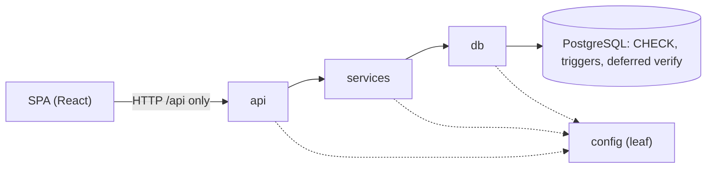
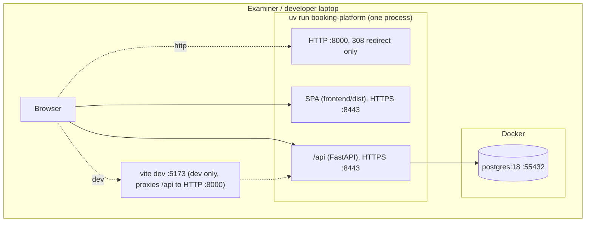
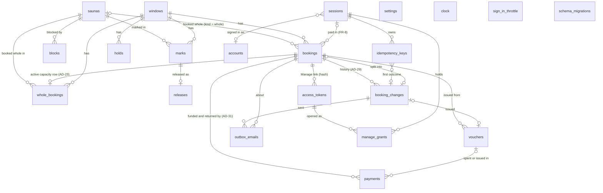

# Architecture Spine: Saunalöyly Booking Platform

## Design Paradigm

**Layered, around a database-enforced invariant kernel.** Three backend layers with one direction of dependency, and PostgreSQL as the final word on capacity. The browser runs a React SPA that knows the platform only through the HTTP API.

| Layer | Lives in | Owns |
| --- | --- | --- |
| SPA | `frontend/` | Pages, page copy, UX checks (never authoritative) |
| api | `src/booking_platform/api/` | HTTP: routing, Pydantic shape validation, role check, the code → status table |
| services | `src/booking_platform/services/` | Application rules, one transaction per user action, email text, catch-up |
| db | `src/booking_platform/db/` + `migrations/` | All SQL, pool, `run()` with retry, `lock_windows()`, translating store refusals; the schema enforces capacity and Placement |
| config | `src/booking_platform/config.py` | Leaf module: deployment settings and test switches; importable by every layer |



## Invariants & Rules

### AD-1: Dependencies point one way, and so do refusals [ADOPTED]

- **Binds:** all backend code
- **Prevents:** rules scattered across routes, SQL in routes, and each story inventing its own error class and constraint mapping.
- **Rule:** `api` imports `services`, `services` imports `db`, and all three may import `config`. `db` imports nothing above it. SQL text appears only in `db/` and `migrations/`. `api` holds no business rule and never opens a connection. Every refusal is one exception type, `services.errors.Refused(code, **facts)`:
  - `services` raises it;
  - `db` translates store errors into it by constraint name. Every refusal a store trigger raises names itself (`RAISE … USING ERRCODE = '23514', CONSTRAINT = '<name>'`), and `db` maps by that name, at COMMIT too. An unnamed or unmapped store error is a 500, never a refusal, and its store text never reaches `message`;
  - `api/errors.py` maps codes to HTTP status (AD-16).

### AD-2: The store is the last word on capacity [ADOPTED]

- **Binds:** FR-10, FR-11, FR-12, FR-29, FR-31, FR-32, FR-35, FR-40, FR-41; every table that changes Seat capacity, Seats booked or Seats held
- **Prevents:** a capacity rule that holds only when the application is used correctly.
- **Rule:** capacity and Placement rules are enforced in PostgreSQL by:
  - the counters `windows.seat_capacity`, `booked` and `held`;
  - `CHECK booked_within_capacity`;
  - the recompute triggers;
  - the deferred `verify_window`.

  Any new table or column that changes these numbers gets the same parts: a BEFORE trigger that locks the Window, an AFTER trigger that recomputes, inclusion in `verify_window`, a bypass test that writes around the API, and an entry in the test harness's `MUTATIONS`. The story that adds a store rule also adds its `MUTATIONS` entry and the bypass test that turns red under it. Python may check the same rule first to give a better message, but never instead of the store. Rules that do not touch capacity (Booking horizon, Booking deadline, Cutoff, throttle, one-time keys) are decided and refused in `services`. The SQL helpers that compute them and the defensive CHECKs already in `0001` stay, and more may be added.

### AD-3: One user action = one transaction, Windows locked first [ADOPTED]

- **Binds:** every state-changing service action
- **Prevents:** partial writes (FR-14 "nothing written"), deadlocks from inconsistent lock order, and refusals that roll back the record they must keep.
- **Rule:** each action runs inside exactly one `db.run(work)`.
  - **Locking:** an action that reads before it writes, or writes more than one statement, calls `db.lock_windows(c, ids)` with every Window it can touch before its first write. Several Windows are locked in id order inside that function. A single-statement write may rely on the BEFORE lock triggers.
  - **Scope:** everything the action produces is written in that transaction: Booking, payment record, Outbox email, one-time-key outcome and session change.
  - **Refusals:** a refusal that must keep a record (a sign-in failure, for example) is returned from `work`, so the transaction commits, and is raised after `db.run` returns. Only refusals that write nothing are raised inside `work`.
  - **Booking-scoped actions:** an action that starts from an existing Booking (cancel, move) reads its `window_id` without a lock, calls `lock_windows` with that Window and any target, then re-reads the Booking (`FOR NO KEY UPDATE`). If `window_id` changed, it raises the retryable conflict and `db.run` starts it again. No row lock is taken before `lock_windows`, and time rules are judged only on the re-read.
  - **Waits:** no Window lock is held across a wait: network calls, sleeps, password hashing, or anything outside the process.
  - **Retry:** temporary conflicts (40001, 40P01) are retried only by `db.run`. The only retry inside services is the Booking-reference claim (AD-20).
  - **Isolation:** `db.run` runs every transaction at READ COMMITTED, set explicitly on the pool. The read-lock-re-read above, AD-9's key read and AD-30's conditional spend rely on each statement after the lock seeing every earlier commit. No story raises the level.

### AD-4: Time comes from the store; Venue rules live in `settings`; reads never write [ADOPTED]

- **Binds:** NFR-3, NFR-11, FR-13, FR-21, FR-39; Booking horizon, Booking deadline, Cutoff, Hold expiry, Release time, throttle, session expiry, retention, remedy limit
- **Prevents:** a rule judged on two clocks or with two different edges, a value hard-coded in three places, and GET requests that take Window locks.
- **Rule:**
  - **Clock:** every time rule reads `app_now()` inside the transaction, after the lock. Python never uses `datetime.now()` for a rule, and the SPA never uses the browser clock for one.
  - **Values:** every Venue rule value (Booking horizon, Booking deadline, Cutoffs, Release time, `venue_tz`) is a column of the `settings` row, with the PRD default. The Booking horizon is added in the Core.
  - **Predicates:** each time-rule predicate is one SQL function (`booking_deadline(wid)`, `within_horizon(wid)`, `venue_date(wid)` …). The listing and the action both call it. `window_started(wid)` (`app_now() >= lower(during)`) is the only started test; `already_started` and `whole_bookable` both call it.
  - **Cutoffs:** each Booking stores its own `cutoff` (an interval before the Window starts), copied from the `settings` Cutoff for its kind (`cutoff_seats` 12 h, `cutoff_whole` 72 h, each with `CHECK >= interval '2 hours'`) when it is created and kept on a move or split. `change_allowed(booking_id)` (`app_now() < lower(during) - cutoff`) is the one Cutoff predicate, so a changed setting applies only to new Bookings (FR-39). The §4.8 migration adds `settings.cutoff_seats` and `bookings.cutoff interval NOT NULL`, filled from `cutoff_seats` (every Booking is a Seat booking then); the §4.9 migration adds `settings.cutoff_whole`.
  - **Venue dates:** a cast of a `timestamptz` to `date` or `time` without `AT TIME ZONE settings.venue_tz` is forbidden. The pool sets `TimeZone = 'UTC'`.
  - **No jobs:** there are no background jobs or timers. A due effect is evaluated as a condition when it is read. For example, the booking list masks a Guest who is past retention.
  - **Catch-up:** effects are materialised only at startup or by a write that touches the row, through one function per effect in `services/catchup.py`.
  - **Reads never write:** GET endpoints never write, with two exceptions. `windows.ensure_generated()` runs before Window listings: it inserts only new Windows, after the stored high-water mark `settings.windows_generated_through`, and under an advisory lock. The sliding touch of a session's expiry (AD-8) and of a grant's `last_used_at` (AD-28) is one autocommit statement outside every action transaction; no action writes `sessions` or `manage_grants` before `lock_windows`.
  - **Test clock:** tests move the clock only by writing `clock.off` directly.

### AD-5: Seats left is read from the rows [ADOPTED]

- **Binds:** FR-3, FR-12, FR-16, FR-35
- **Prevents:** the Guest and Administrator lists showing different numbers, and a stale counter hiding a release or an expired Hold.
- **Rule:** every Seats left, Seats booked and Seat capacity shown anywhere comes from the SQL functions `seats_left()`, `window_booked_seats()` and `window_open_capacity()`. It never comes from the stored counters, and it is never computed in Python or in the SPA.

### AD-6: Placement is derived, never stored [ADOPTED]

- **Binds:** FR-4, FR-29, FR-30, FR-31, FR-40, FR-41
- **Prevents:** Seats tied to a Sauna, which would turn Whole-sauna bookings, Blocks and Fill-order changes into rewrites.
- **Rule:** a Sauna reference exists only on Whole-sauna bookings, Blocks and Whole-booking-only marks. A Seat booking carries a Window and a Seat count, never a Sauna (AD-23). Placement is computed when it is read. A nullable "placed in Sauna" column is added only if one-Sauna access (Vision) is built.

### AD-7: Bookings are never deleted [ADOPTED]

- **Binds:** FR-16, FR-26, FR-40, FR-42
- **Prevents:** a cancellation path that deletes rows, which loses history and breaks the Overbooking fallback.
- **Rule:** migration `0002` makes these changes:
  - it adds `bookings.status` (`active` | `cancelled`);
  - it adds `entry_time` (default `app_now()`; kept apart from `created_at`, the time of booking);
  - it makes `window_booked_seats()` count only active rows;
  - it restricts the `bookings` triggers to `INSERT`, `DELETE` and `UPDATE OF window_id, seats, status`.

  A cancellation sets the status in the same transaction as its cause, and records it as AD-29 says. A Change is a history row (from If-time 2, AD-29), never a third status. History rows are written only by `services`, in the Change's transaction, never by a trigger. A Whole-sauna move leaves `entry_time` unchanged; it is used only by the Overbooking fallback for Seat bookings. A Block that would leave too little capacity first makes room in its own transaction (FR-40 D3 order) and then inserts the Block. The store keeps refusing an over-capacity Block.

### AD-8: Sessions are server-side rows with hashed tokens [ADOPTED]

- **Binds:** FR-8, FR-15, FR-20, FR-24, FR-25, FR-35, FR-37; later remedy and account tokens (FR-37, FR-42)
- **Prevents:** a sign-out that does not revoke, client-chosen identities, lost-response double bookings, and each feature inventing its own token storage.
- **Rule:**
  - **Storage:** one `sessions` table holds anonymous and signed-in browsers, with a role per row. The cookie holds a 256-bit random token: HttpOnly, `SameSite=Strict`, `Path=/`, and `Secure` whenever `BP_HTTPS` is on (AD-27). The store keeps only the SHA-256 hash of the token.
  - **References:** everything references `sessions.id`. The foreign keys from `bookings` and `holds` are `ON DELETE SET NULL`, and the one from `idempotency_keys` is `CASCADE`. The slice's client-supplied `session_id` is replaced.
  - **Creation:** the SPA calls `POST /api/session` when a Guest opens Book seats or an Administrator opens Sign-in, and after a `401 no_session` during a booking; `POST /api/manage/open` (AD-28) also creates one. No other page load creates a session, so Landing, Terms and Privacy notice set no cookie (FR-21; the PRD's cookie sentence adds opening a Manage link). That call creates an anonymous session, or returns the existing one if it is still valid. A Guest write without a session gets `401 no_session`.
  - **Lifetimes:** anonymous sessions last 24 h and Administrator sessions 8 h, both sliding.
  - **Sign-in and sign-out:** sign-in rotates the token on the same row and sets its role, so the row id never changes. Sign-out deletes the row and, by cascade, its Manage grants. Expired rows are purged at startup.
  - **CSRF:** every state-changing request must carry a JSON body and be same-origin: its `Origin` equals the base URL's origin, or, without `Origin`, it carries `Sec-Fetch-Site: same-origin`. It is never compared with `Host` (AD-27). There are no CSRF tokens.
  - **Manage access:** a Manage-link grant (AD-28) is a row tied to the session, never a second cookie. The Administrator role never implies a grant, and a grant never implies a role, so both can exist in one browser.
  - **Link tokens:** every token carried in a link (Manage now; remedy, account confirmation and reset later) has at least 128 random bits, lives in `access_tokens` as a SHA-256 hash only (AD-28), and an invalid token gets the same response as an unknown one. Codes that people type (Vouchers, later Gift cards) follow AD-30 instead.

### AD-9: Repeated submits return the first outcome [ADOPTED]

- **Binds:** FR-6, FR-7, FR-25, FR-26, FR-27, FR-28, FR-29, FR-33
- **Prevents:** a double click creating two Bookings, charges or Changes, a paying Guest seeing an error, a failed payment that can never be retried, and a repeat answered from a Booking that a later Change has altered.
- **Rule:** every confirming request carries an `Idempotency-Key` UUID made by the SPA.
  - **Booking keys:** made when the Guest reaches the review page and reused for every retry until the booking is paid. The key lives with the draft in `sessionStorage` (`draft:seats`, `draft:whole`), so a reload in the same tab keeps it. After `409 invalid_key` the SPA never makes a new booking key on its own.
  - **Change keys:** made when a confirming step on the Manage page opens, in the slot `draft:change:<reference>:<action>`. The slot is deleted on success, on any refusal other than `503 try_again`, and when the Guest leaves the step; a reload of the same step reuses it. After `409 invalid_key` or `409 booking_changed` the Manage page reloads the Booking and opens a fresh step with a new key.
  - **Table:** `idempotency_keys(key UNIQUE, session_id, endpoint, request_hash, booking_id, change_id)`, with exactly one of `booking_id` and `change_id` set. `request_hash` is SHA-256 of the canonical outcome-defining fields (kind, Window, Seats, Sauna, Voucher part, reference, action, target Window, target Sauna, remedy, `version`), never of name, email or Voucher code. Ids and hashes only, never personal data.
  - **Order:** the key is read as the first statement after `lock_windows` (for a Change, after the Booking re-read).
  - **Repeats:** a known key from the same session with the same `endpoint` and `request_hash` writes nothing and returns the first outcome: the emails that action sent, read by id (AD-12), plus the Booking as it is now in the AD-23 serializer. Any other known key is `409 invalid_key`. A repeat never compares the request with the current Booking or Change row.
  - **What is stored:** only a success is stored. A refusal or a failed payment stores nothing, so the retry runs again.

### AD-10: Administrator access is decided at the router [ADOPTED]

- **Binds:** FR-16, FR-17, FR-20, IV-7, RB-1 to RB-4
- **Prevents:** an Administrator endpoint that someone forgot to protect, and API typos that answer with the SPA.
- **Rule:** every Administrator endpoint is under `/api/admin/`, on one router whose dependency requires an Administrator session.
  - Anonymous callers get 401, and non-Administrators get 403. Neither changes anything.
  - Asking for something that is not the caller's answers exactly like something that does not exist (404).
  - Any unknown `/api/*` path returns the JSON 404 envelope and never the SPA.
  - `/health` becomes `/api/health`.

### AD-11: Sign-in is throttled per email, serialised in the store [ADOPTED]

- **Binds:** FR-15, FR-19, FR-37, PW-1 to PW-6
- **Prevents:** a throttle that resets on restart, reveals whether an account exists, or lets parallel guesses slip through.
- **Rule:**
  - **Throttle table:** `sign_in_throttle(email_lower PRIMARY KEY, failures, locked_until)`, with no foreign key to accounts.
  - **Order:** each sign-in first upserts and locks its row (`FOR UPDATE`), then decides. Thresholds follow FR-15.
  - **Refusals:** a refusal is the same 401 and message as a wrong password, and it is recorded by returning it from `work` (AD-3).
  - **Passwords:** Argon2id, with the `argon2-cffi` defaults in PHC format, rehashed at sign-in when the parameters change.
  - **Password rules:** FR-19 is checked in one service function, used by the seed, `create-admin` and later sign-up. The common-password list is a data file in the package.

### AD-12: Email is written only through the Outbox service [ADOPTED]

- **Binds:** FR-1, FR-5, FR-8, FR-17, FR-21, every email in PRD §7
- **Prevents:** emails sent outside the action's transaction, a confirmation page that cannot find its email, and terms or links that drift between page and email.
- **Rule:**
  - **Sending:** `services.outbox.send(c, to, subject, body, *, booking_id=None, change_id=None)` is the only sender. It is called inside the action's transaction and returns the email id. Every email a Change sends carries its `change_id` (`outbox_emails.change_id`, FK `booking_changes`), so a repeat (AD-9) returns exactly those emails.
  - **Format:** bodies are plain English text, built in `services`.
  - **Links:** links are absolute, built from the configured base URL, which starts with `https://` whenever `BP_HTTPS` is on (FR-24, HT-4). Paths and anchors are constants in `config.links`. A Manage link is `<base>/manage#t=<token>` (AD-28); no token ever goes in a path or query string. Only an email that comes with a new token carries a Manage link (the confirmation and the split-off Booking's email).
  - **Shared text:** text that appears both on a page and in an email (the booking terms, "what happens next") lives once in `content/`, and both the SPA build and `services` read it from there. Text that differs by kind has one file per kind (`terms-seats`, `terms-whole`), and both select it by the Booking's `kind`.
  - **UI word:** all text that people read, in `content/`, email bodies and the SPA, says "session" for a Window (PRD §3). Code, API fields and the store keep Window.
  - **Guest read:** a Guest sees an email only with the action that sent it. The confirmation read `GET /api/bookings/{reference}/confirmation` is checked against the paying session (404 otherwise) and returns the Booking facts plus the stored email; the SPA route is `/confirmation/:reference`. Each Change returns its emails in its own response (AD-29 lists them); the Manage page read never returns an email (AD-28).
  - **Administrator read:** only the Administrator API lists the Outbox.
  - **Retention:** retention clears the recipient and body of emails linked to an anonymised Booking.

### AD-13: Payment is one synchronous function in the same transaction [ADOPTED]

- **Binds:** FR-6, FR-7, FR-28, FR-36, NFR-4
- **Prevents:** a charge without a Booking, a Booking without a charge, two different "total paid" figures, and floating-point money.
- **Rule:**
  - **Money:** amounts are an integer number of øre (NOK including VAT) everywhere.
  - **Booking value:** `bookings.total_ore` and `price_per_seat_ore` are the Booking's value. They are what every page and email shows, and they are never recomputed from current prices. The one recomputation: a Change that alters a Seat booking's Seats sets `total_ore = seats × price_per_seat_ore` of that same Booking (AD-29).
  - **Payments:** `payments(booking_id, direction, method, amount_ore, voucher_id)` rows record how the value was funded and returned. `direction` is `charge` or `refund`, `method` is `card` or `voucher`, `amount_ore > 0`, and `voucher_id` is set exactly when `method = 'voucher'`. Only refunds and the audit read them.
  - **Charging:** `services.payment.charge()` decides the card part's outcome before `lock_windows` and writes its row after the lock, in the same transaction. A Voucher part is spent after the lock by AD-30. When the Voucher covers the whole total, `charge()` is not called and no card row is written.
  - **Refunds:** AD-31.

### AD-14: Test switches are a startup file read at fixed seams [ADOPTED]

- **Binds:** FR-7, FR-14, FR-36, FR-49, the Test switch in the glossary
- **Prevents:** switches reachable through the API, test hooks scattered through the code, and switches that block startup.
- **Rule:** `config/test-switches.toml` is git-ignored, and `config/test-switches.example.toml` (all switches off) is committed. The file is read once at startup into a frozen object in `config`. Switches are read only at named seams:
  - `payment.charge`: `payment = "ok" | "fail" | "hold"`. With `hold`, the charge raises before anything is written, and the action returns `409 payment_pending`. The test then moves the clock and resubmits with the same key.
  - `db.run`: `force_conflict` raises a real rollback after `work` has written. It applies only to runs made for an HTTP request, never to migrations, seeding or startup catch-up.
  - Later, the lock simulator.

  No endpoint reads or changes a switch. The trigger-based FR-14 test that produces a real 40001 stays alongside.

### AD-15: The schema changes only through numbered SQL migrations [ADOPTED]

- **Binds:** `migrations/`, DR-4
- **Prevents:** conflicting schema edits, skipped migrations, migrations that hold reference data, and a database that cannot be reproduced.
- **Rule:**
  - **Files:** migrations are plain SQL files named `migrations/NNNN_short_name.sql`. They create structure and singleton rows only, never reference values (AD-18).
  - **Runner:** the runner applies them in order at startup and at the start of the test run. It records full file names in `schema_migrations` and refuses to start if two files share a number.
  - **Existing databases:** a database that has `windows` but no `schema_migrations` counts as having `0001` applied.
  - **Numbering:** a story takes its number when it merges, not when it starts.
  - **Changes:** a merged migration is never edited.
  - **0001:** `0001` is the slice's `schema.sql`, moved unchanged.

### AD-16: The server returns codes and facts; the SPA owns page copy [ADOPTED]

- **Binds:** FR-2, FR-3, FR-11, FR-12, FR-14, FR-18, FR-22, NFR-5, NFR-9
- **Prevents:** one refusal with two codes or two statuses, and the same refusal worded differently on different pages.
- **Rule:**
  - **Code table:** every refusal code is declared once in `api/errors.py`, with its status and facts, and the SPA mirrors that table. The table starts with the slice's codes. §4.9 adds `outside_horizon` (shared with the Core), `sauna_unavailable`, `price_differs` and `cutoff_passed` (shared with §4.8). A move to a Window without room is the same `no_seat_free`, with the target's `seats_left`. §4.8 adds `booking_cancelled`, `booking_changed` (the Booking's `version` moved on; fact: the current Booking), `change_invalid` (fact `reason`: `seats_exceed` or `same_target`) and `voucher_invalid` (one code, without facts, for unknown, malformed, expired, used-up or raced Vouchers, FR-28). `cutoff_passed` carries `cutoff_at`. An unknown, expired or replaced Manage link, and a reference the session has no grant for, are the plain `404 not_found` (AD-10, AD-28).
  - **Refusals on Review:** `no_seat_free` carries `seats_left`. At 0 the SPA says "No seat free", and above 0 it states the true number. A Window past its Booking deadline is refused with `deadline_passed`.
  - **Time facts:** the SPA may not use the browser clock (AD-4), so listings send what the pages show. Each Window carries `already_started`, and each listing carries `horizon_end` (a Venue date) and `horizon_days`. All three come from the AD-4 predicates and `settings`, and the SPA never computes them.
  - **Status codes:** 422 is used only for shape errors from Pydantic. Every rule judged against the store or the clock (horizon, deadline, capacity, Cutoff) is a 409 from `services` after the lock.
  - **Envelope:** refusals use the envelope from the Conventions. Its `message` is optional, is meant for developers, and never contains store text.
  - **Success bodies:** successful responses are bare JSON objects.
  - **Copy:** page copy lives in the SPA, email copy in `services`, and copy used by both in `content/` (AD-12).
  - **Venue facts:** facts about the Venue that pages show (Saunas, prices including Whole-sauna prices, Window schedule, contact) come from the API, never hard-coded in the SPA.

### AD-17: The SPA reaches the server through one client module [ADOPTED]

- **Binds:** all of `frontend/`
- **Prevents:** idempotency keys, error handling or credentials handled differently from page to page.
- **Rule:** `frontend/src/api.js` is the only module that calls `fetch`.
  - It uses relative `/api/…` URLs and same-origin cookies.
  - It sets `Idempotency-Key` (AD-9) and turns the error envelope into one error type.
  - No page talks to any other origin (FR-21).
  - Routing uses `react-router` in Data mode (`createBrowserRouter`), never `react-router-dom` or framework mode.

### AD-18: Reference data comes from `seeds/`, applied idempotently at every start [ADOPTED]

- **Binds:** FR-13, FR-15, NFR-1, NFR-10, DR-2, DR-5
- **Prevents:** a fresh clone with no bookable dates, duplicate Windows or sample Bookings on restart, reference values held in migrations, and a restart that undoes an Administrator change.
- **Rule:** after migrations, startup applies `seeds/` in every environment:
  - **Contents:** Saunas, Capacities, Fill order, Bookable-whole marks, Seat and Whole-sauna prices, Setting values, the Window schedule, the Administrator and the sample Bookings.
  - **Writes:** the seed writes a value only where the row is absent, or where a reference column the seed owns is NULL; it never overwrites a value. After the first start, the store owns the value. A new reference column gets the seed value as its default in the same change, and a per-row reference column (such as `saunas.whole_price_ore`) is added nullable and filled by the seed.
  - **Windows:** Windows are generated by `windows.ensure_generated()` (AD-4), counting from the Venue date of `app_now()`.
  - **Sample Bookings:** they are created through `services.booking.create`, under one fixed seed session and fixed idempotency keys, so a rerun is a no-op. The §4.8 story gives each sample Booking without a Manage token one, with its Outbox email; the README says these links work until their Windows end.
  - **Validation:** the seed goes through the same validation as Administrator input (IV-6).
  - **Administrator:** the seeded Administrator's credentials are documented in the README. Other Administrators are created only by `uv run booking-platform create-admin`.

### AD-19: Nothing secret is logged [ADOPTED]

- **Binds:** FR-19, FR-21
- **Prevents:** passwords, session tokens, Manage-link tokens or Door codes ending up in logs.
- **Rule:** request bodies, headers and cookies are never logged. Log lines name ids and error codes only. Tokens never appear in a URL path or query (AD-12, AD-28), so the uvicorn access log may stay on. Voucher codes travel only in request bodies and emails.

### AD-20: One way to create a Booking reference [ADOPTED]

- **Binds:** FR-8, FR-16, FR-26, AD-18
- **Prevents:** reference retries that abort the transaction or swallow a capacity refusal.
- **Rule:** a reference is 8 characters of upper-case Crockford base32. `services.reference` inserts the Booking with `ON CONFLICT (reference) DO NOTHING RETURNING id` and tries a new candidate at most 5 times. It raises no exception and uses no savepoint. Every Booking creator uses it: the Seat flow, the Whole-sauna flow, the seed and a split.

### AD-21: The slice is reshaped, never loosened [ADOPTED]

- **Binds:** the first skeleton story; `tests/`
- **Prevents:** the FR-10 proof turning red and being "fixed" by weakening a rule.
- **Rule:** the first skeleton story moves the slice to this spine:
  - the `/api` paths;
  - the router-level Administrator access;
  - server sessions;
  - Seats 1–10;
  - the migration runner.

  The slice's tests are kept as regression proof. They sign in through a test fixture and fill Windows with several Bookings of at most 10 Seats each, or with raw inserts. No rule is loosened to keep a slice test green.

### AD-22: Deployment configuration comes from `BP_*` environment variables [ADOPTED]

- **Binds:** NFR-1, DR-5, FR-24
- **Prevents:** deployment values spread through the code, and Venue rules split between Python and the store.
- **Rule:** `config.py` is the only reader of the `BP_*` environment variables:
  - the database URL;
  - the base URL (default `https://localhost:8443` with HTTPS on, `http://localhost:8000` with it off);
  - `BP_HTTPS` (default on), `BP_HTTPS_PORT` (8443), `BP_HTTP_PORT` (8000), `BP_CERT_DIR` (`certs/`) and `BP_HSTS_MAX_AGE` (3600), see AD-27;
  - the host;
  - the test variables already in use.

  Each variable has a working local default, so no file is needed. Venue rules never live there (AD-4). Until the FR-24 story merges there is no `BP_HTTPS`, and the platform behaves as with it off; that story adds the variable and everything else in AD-27 in one PR. The platform runs as one process, without `--workers`; with HTTPS on it holds the two listeners of AD-27.

### AD-23: A Whole-sauna booking is a Booking, paired with its capacity row

- **Binds:** FR-16, FR-29, FR-30, FR-33; `bookings`, `whole_bookings`, `saunas`
- **Prevents:** two owners of the Booking reference, payments and Outbox emails; a cancelled Whole-sauna booking that still takes capacity; a cancelled Booking that no longer knows its Sauna; two Booking shapes.
- **Rule:**
  - **One Booking table:** a Whole-sauna booking is a `bookings` row with `kind = 'whole'`, `sauna_id` set and `seats` NULL. A Seat booking has `kind = 'seats'`, `seats` 1–10 and `sauna_id` NULL. A CHECK ties the three columns, and a BEFORE UPDATE trigger refuses any change of `kind`. Reference (AD-20), status (AD-7), payments, Outbox emails, idempotency keys and Manage links attach to `bookings` only.
  - **Capacity row:** `whole_bookings` stays the row the capacity triggers read, with `booking_id UNIQUE NOT NULL REFERENCES bookings`. It exists exactly while its Booking is active, with the same `window_id` and `sauna_id`. One function, `check_whole_pair(booking_id)`, is called by two `DEFERRABLE INITIALLY DEFERRED` constraint triggers: one on `bookings` (INSERT, `UPDATE OF kind, status, window_id, sauna_id`) and one on `whole_bookings` (INSERT, UPDATE, DELETE, checking the old and new `booking_id`). It raises `CONSTRAINT = 'whole_pairing'`, which is a 500 (AD-1).
  - **Write order:** create writes the Booking first (AD-20), then `whole_bookings`. Cancel sets the status first, then deletes the capacity row. Move updates `bookings` first, then `whole_bookings`, with `window_id` and `sauna_id` together.
  - **Counting:** `window_booked_seats()` counts active `kind = 'seats'` rows only. No other code sums `bookings.seats`.
  - **Move:** a move may change the Window and, when the Guest picks another Sauna, the Sauna. It follows AD-3's Booking-scoped order. After the lock, `services` checks `within_horizon` and the Booking deadline of the target and `change_allowed` of the Booking (their own codes, AD-24), and the store judges `whole_bookable(target_wid, target_sid, booking_id)`. The reference is kept, the history row is written by `services` (AD-7), and `entry_time` is unchanged.
  - **Price:** `saunas.whole_price_ore` is one price per Sauna, nullable and filled by the seed (AD-18). A NULL price means the Sauna is not offered whole. The Booking stores `total_ore`, and `price_per_seat_ore` is NULL. A move to another Sauna whose `whole_price_ore` differs from the Booking's `total_ore` is refused with `price_differs`; a move that keeps the Sauna keeps the price paid.
  - **Cutoff:** the Whole-sauna Cutoff (72 hours) is a `settings` value, and each Booking keeps its own copy (AD-4).
  - **Shape:** one serializer in `services` produces every Booking JSON and every email fact block: `kind`, `seats` (int or null), `sauna` (`{id, name}` or null), `window`, `total_ore`, `status`. Pages show the Sauna name for a Whole-sauna booking and never its Capacity.
  - **Slice path:** the story that adds `kind` and `booking_id` removes the slice's whole-booking endpoint, so `services.whole` is the only writer of `whole_bookings`. Slice tests that wrote `whole_bookings` call a test helper `raw_whole(pg, wid, sid)`, which inserts a paired `kind = 'whole'` Booking and its capacity row in one transaction. This is a reshape under AD-21, and every assertion stays. The migration deletes `whole_bookings` rows that have no Booking; only dev and slice databases have them.

### AD-24: FR-29 is judged by one SQL predicate, on every write and every listing

- **Binds:** FR-29, FR-30, FR-33; `trg_check_whole`, the Private sauna listing
- **Prevents:** the Private sauna page offering a pair the booking then refuses, a move that slips past FR-29 (in `0001` the check fires on INSERT only), a row judged against itself, and one refusal with several codes.
- **Rule:**
  - **Predicate:** `whole_bookable(wid int, sid int, ignore_booking bigint DEFAULT NULL)` is the only SQL statement of the store-enforced part of FR-29. It judges as if the `whole_bookings` row of `ignore_booking` did not exist: the Sauna is bookable whole and has a `whole_price_ore`, is not Blocked, is not booked whole, and the Seats booked plus held fit within Room ahead unless `mark_closed(wid, sid)`. The started-Window clause is: not `window_started(wid)`, or no Seat booking, or `mark_closed(wid, sid)`. It never uses `sauna_open_for_seats` of the Sauna being booked.
  - **Store:** `trg_check_whole` fires AFTER INSERT and AFTER `UPDATE OF window_id, sauna_id` of `whole_bookings`, calls `whole_bookable(NEW.window_id, NEW.sauna_id, NEW.booking_id)`, and raises `CONSTRAINT = 'whole_bookable'`. Bypass tests cover INSERT and UPDATE, including a started Window with Seat bookings.
  - **Listing:** `GET /api/private-saunas?date=` returns `{saunas: [{id, name, capacity, whole_price_ore, windows: [{id, start, end, already_started}]}], horizon_end, horizon_days}`. It lists only the pairs where `within_horizon`, the Booking deadline predicate and `whole_bookable(wid, sid)` all hold. The SPA builds both views (by Window and by Sauna) from this response by regrouping only. The Manage page's Whole-sauna move list is the same query with `ignore_booking` = the Booking.
  - **Refusal order:** outside the Booking horizon is `outside_horizon`, past the Booking deadline is `deadline_passed`, past the Cutoff is `cutoff_passed`, each checked in `services` after the lock in that order. Everything else in FR-29 is `409 sauna_unavailable`. In a Whole-sauna action, `db` maps `whole_bookable`, `booked_within_capacity` and the `(window_id, sauna_id)` unique key to `sauna_unavailable`.

### AD-25: Placement has one implementation, shown only to Administrators

- **Binds:** FR-4, FR-31, FR-16 (the Administrator's Placement view)
- **Prevents:** a second Placement algorithm in Python or in the SPA that drifts from the store, and a Sauna leaking into the Seat flow.
- **Rule:**
  - **Function:** `placement(wid)` returns one row per Sauna in Fill order: `(sauna_id, state, seats)`. `state` is `open`, `whole`, `blocked` or `marked`, and `seats` is 0 unless the Sauna is `open`. It places booked Seats only (INV-2); held Seats are reported apart by `window_held_seats`. It is the only computation of Placement. A Python brute-force Placement exists only in `tests/`, as the reference for AD-26.
  - **Exposure:** `placement()` is read only under `/api/admin/`. No response outside `/api/admin/` names a Sauna for a Seat booking or shows a Window's Placement. A Sauna appears in Guest responses only for `kind = 'whole'` and in the Venue facts. A test walks the Seat flow's responses and emails, the `/api/manage/` responses for Seat bookings and their Change emails, and finds no Sauna name.

### AD-26: FR-31 is proven by one Hypothesis state machine through `services`

- **Binds:** FR-31, FR-32 (sequential part), SM-5; every later If-time action that changes Placement
- **Prevents:** one model test per feature, each with its own reference; actions that never meet in one sequence; examples that pollute each other; a test too slow for every `uv run pytest`.
- **Rule:**
  - **Machine:** `tests/test_fr31_placement_model.py` holds one Hypothesis `RuleBasedStateMachine`. Each action is one `@rule` that calls `services` in-process against the real PostgreSQL test database. An `@invariant` checks INV-1 to INV-5 and Seats left after every step, comparing `placement(wid)` with the brute-force reference. Each later If-time item (Blocks, marks, releases, Capacity and Fill order changes) adds its actions as rules to this machine.
  - **Reset:** an `@initialize` rule truncates the mutable tables (`RESTART IDENTITY`), reseeds, and sets the clock. Windows lie far from every time edge, and the clock moves only through an explicit clock rule. The machine reads all test switches as off, whatever the local file says.
  - **Settings:** `deadline=None`. `max_examples` and `stateful_step_count` come from a Hypothesis profile: `default`, small enough for every `uv run pytest`, and `thorough`, chosen with `HYPOTHESIS_PROFILE`. `.hypothesis/` is git-ignored.
  - **Changes:** §4.8 is built before §4.9, so the story that creates the machine includes as `@rule`s the Seat move (all and some Seats), the Voucher for some or all Seats, and the FR-33 move and cancel, over at least two Windows. Seats are cancelled only through FR-27 and Whole-sauna bookings only through FR-33; no test-only endpoint is added (AD-14). An `@invariant` also checks AD-31's ledger rule.
  - **Concurrency:** stays in the parallel API tests (catalogue group C, see Conventions).

### AD-27: HTTPS is served by the platform itself, on one origin, with its own certificate

- **Binds:** FR-24, HT-1 to HT-4, NFR-1, SC9; `__init__.main`, `tls.py`, `app.py`, `config.py`, the test server fixture
- **Prevents:** an extra install for the examiner, a second server owning TLS, an HTTP path that reaches the API, a second origin with its own cookie jar, a cookie or email link that drifts back to `http://`, a certificate that strict clients reject, and a local CA that could vouch for any site.
- **Rule:**
  - **Certificate:** `tls.ensure(cert_dir)` in `src/booking_platform/tls.py` is the only code that touches certificates. `main()` and the test fixture call it. It uses `cryptography`, ECDSA P-256 keys and SHA-256 signatures.
    - **CA:** reused while `ca.pem` and `ca-key.pem` both exist and the CA is valid for more than 30 days more; otherwise a new CA is made, and with it a new leaf. The CA is valid 10 years, with critical `BasicConstraints(ca=True, path_length=0)`, critical `KeyUsage(key_cert_sign, crl_sign)`, a Subject Key Identifier, and a critical `NameConstraints` that permits only `DNS:localhost`, `IP:127.0.0.0/8` and `IP:::1/128`.
    - **Leaf:** made again when it is missing, expires within 30 days, or does not verify against the current `ca.pem`. It is valid 365 days, with SAN `localhost`, `127.0.0.1` and `::1`, critical `BasicConstraints(ca=False)`, critical `KeyUsage(digital_signature)`, `ExtendedKeyUsage(serverAuth)`, and Subject and Authority Key Identifiers.
    - **Files:** `certs/` is git-ignored; `ca-key.pem` is written owner-only where the OS supports it.
  - **One origin:** the base URL's origin is the platform's only origin. With `BP_HTTPS` on, `config` derives the default base URL `https://localhost:<BP_HTTPS_PORT>` and refuses to start when the base URL is not `https://` on a certificate name. The HTTPS app answers a request whose `Host` is not the base URL's host and port with `308` to the base URL plus the same path and query. AD-8's same-origin check compares with the base URL, never with `Host`.
  - **Listeners:** with `BP_HTTPS` on, `main()` calls `tls.ensure`, then binds every socket itself (both ports, each on `127.0.0.1` and on `::1` where available) before any server or lifespan starts. A busy port ends the process non-zero with one line naming the port and its `BP_*` variable. It then runs two `uvicorn.Server`s in one event loop on those sockets: the app with TLS, and a redirect-only ASGI app with `lifespan="off"`. If either server stops, `main()` stops the other and exits non-zero when either failed. Ctrl+C stops both without a traceback.
  - **Redirect:** every HTTP request gets `308` with `Location` = base URL + the request's raw `raw_path` and `query_string` bytes (never decoded) and `Cache-Control: no-store`. A target holding CR, LF or bytes outside visible ASCII gets `400` without `Location`. The redirect app never calls the app, reads no body or cookie, and sets nothing.
  - **Headers:** one pure ASGI wrapper, which `main()` puts around the whole app outside Starlette's error middleware, so error responses carry them too. It adds `Strict-Transport-Security: max-age=<BP_HSTS_MAX_AGE>` (no `includeSubDomains`, no `preload`) when HTTPS is on, `Referrer-Policy: no-referrer` always, `Cache-Control: no-store` on `/api/`, and `X-Robots-Tag: noindex` on `/manage` and `/api/manage/`.
  - **Cookies and links:** with HTTPS on, the session cookie is `Secure` (AD-8), and every email link starts with the base URL (AD-12).
  - **Environments:** the examiner and the tests run with HTTPS on. `uv run booking-platform dev` first sets `BP_HTTPS=0` and, unless already set, `BP_BASE_URL=http://127.0.0.1:5173` in `os.environ`, then calls `uvicorn.run(…, reload=True)`; it never calls `tls.py`. Vite listens on `127.0.0.1`.
  - **Tests:** the fixture calls `tls.ensure` on a temp cert dir, then starts the `booking-platform` entry point with two free ports, `BP_BASE_URL=https://localhost:<port>` and that cert dir, and waits for `/api/health` over TLS. The slice fixture is reshaped to this under AD-21. HTTP clients verify with an `ssl.SSLContext` loaded from that `ca.pem`; Playwright uses `ignore_https_errors`. `tests/test_fr24_https.py` holds:
    - HT-1, with a client that keeps no HSTS state: `308`, and nothing changed;
    - HT-2, the headers on a 200, a 404 envelope and a static asset;
    - HT-3, every `Set-Cookie` has `Secure`, `HttpOnly`, `SameSite=Strict` and `Path=/`, and the redirect listener answers byte for byte the same with and without a `Cookie` header;
    - HT-4, every Outbox link starts with the test base URL.
  - **Known limits:** browsers treat `localhost` as secure, so they still send `Secure` cookies to `http://localhost`. Chrome (since M132) and Firefox ignore HSTS from `localhost`, and Safari does not. HT-3 therefore checks the cookie attributes, and the README states the deviation from FR-24's "never sent over HTTP" on `localhost`.
  - **README:** the browser warns once; importing `certs/ca.pem` is optional and trusts it only for the `localhost` names; `ca-key.pem` is never shared; the import is removed after grading; `curl -i http://localhost:8000/` shows HT-1; a production deployment would use a public certificate and one year of HSTS.

### AD-28: A Manage link is a fragment token exchanged for a grant on the session

- **Binds:** FR-17, FR-20 (RB-4, RB-5), FR-21, FR-25 to FR-27, FR-33, FR-34 (later); `access_tokens`, `manage_grants`, `/api/manage/`
- **Prevents:** a token in access logs, referrers or browser history, a second token store per feature, a Change that silently kills the Guest's link, a revoked link that still works through an open page, a grant that outlives a moved Window, a Change route that reaches the wrong kind of Booking, and a Manage page that answers differently for unknown and expired links.
- **Rule:**
  - **Storage:** `access_tokens(id, purpose, booking_id, token_hash bytea UNIQUE, created_at, revoked_at)`. `purpose` is `manage` now; later items extend its CHECK and add their own nullable columns, and validity is decided per purpose in `services.manage`. The index `access_tokens_one_manage ON access_tokens (booking_id) WHERE purpose = 'manage' AND revoked_at IS NULL` is unique. Only `services.manage` writes the table.
  - **Issue:** `services.manage.issue(c, booking_id)` locks the Booking row `FOR NO KEY UPDATE` (after `lock_windows` when the action has one), revokes any unrevoked `manage` token of the Booking, then stores the SHA-256 hash of a new 256-bit token (`secrets.token_urlsafe(32)`). It returns the raw token only to build the email link. Only Booking creators call it: the Seat flow, the Whole-sauna flow, a split, the seed, and later FR-34. No Change revokes or issues a token, so the original Booking keeps its link (FR-26). No token is issued afterwards for Bookings made before §4.8, except the seed's (AD-18).
  - **Validity:** a token opens its Booking while it is unrevoked and `app_now()` is before the end of the Booking's current Window. Validity is judged by join and never stored, so a move changes it at once.
  - **Open:** the SPA route `/manage` reads `#t=`, removes the fragment with `history.replaceState`, and sends `POST /api/manage/open {token}`. That call creates or reuses the session (AD-8), checks the token, upserts `manage_grants(session_id, token_id, last_used_at)` (UNIQUE `(session_id, token_id)`) and returns `{reference}`. The SPA then goes to `/manage/:reference`. An unknown, revoked or expired token is `404 not_found`.
  - **Grant:** `manage_grant_valid(session_id, booking_id)` is the one predicate: `app_now() < last_used_at + interval '30 minutes'`, the token is valid as above, and it is unrevoked. Grants cascade with their session, so sign-out ends them. One session may hold grants for several Bookings. A split inserts a grant for the new Booking after the lock. Startup purges grants of expired sessions and of tokens whose Window has ended.
  - **Access:** every Guest route reached through a grant is under `/api/manage/{reference}/`, on one router. Its dependency checks the grant before the action and answers `404 not_found` otherwise, with or without a session (AD-8's `401 no_session` belongs to the booking flow only). It then touches `last_used_at` (AD-4). The action re-checks the grant by join after the Booking re-read.
  - **Routes per kind:** `POST …/seats/move {window_id, seats, version}` and `…/seats/voucher {seats, version}` for `kind = 'seats'`; `…/whole/move {window_id, sauna_id, version}` and `…/whole/cancel {remedy, version}` for `kind = 'whole'`. A route of the other kind answers `404 not_found`. Each is a confirming `POST` with a key (AD-9).
  - **Read:** `GET /api/manage/{reference}` changes nothing (apart from the touch). It returns the AD-23 serializer plus `version`, `change_allowed`, `cutoff_at` and the history entries (action, time, Seats, Windows, Saunas for a Whole-sauna booking, Voucher value). It never returns an Outbox body, a Voucher code or a Manage link; those appear only in the response of the action that made them (FR-17).

### AD-29: A Change is one versioned step with one history row; a cancellation records when, why and the remedy

- **Binds:** FR-16, FR-26, FR-27, FR-33, FR-40 and FR-42 (fields only); `bookings`, `booking_changes`
- **Prevents:** a stale tab turning a partial move into a full one, Changes recorded in different shapes, a third status, a split that loses the original's price or Cutoff, two paths to the same cancellation, a cancellation the Administrator cannot explain, and a Seat booking refunded in money at the Guest's request.
- **Rule:**
  - **Version:** `bookings.version int NOT NULL DEFAULT 0` is incremented by every Change and cancellation, in the same UPDATE. It is not in AD-7's trigger column list. Every Booking JSON carries `version`, and every Change request carries the `version` the Guest saw.
  - **Order of checks:** after the lock, the Booking re-read, the grant re-check and the key read (AD-9): `booking_cancelled`; `booking_changed` when the version differs; `change_invalid` (`seats_exceed` when Seats are outside 1 to the Booking's Seats, `same_target` when the target equals the current Window and Sauna); then AD-24's order (`outside_horizon` and `deadline_passed` for a target Window, `cutoff_passed` for the Booking); then capacity in the store.
  - **Seat move (FR-26):** Seats equal to the Booking's Seats → `UPDATE window_id`, reference kept, `entry_time = app_now()`. Fewer Seats → a split. The original keeps its reference and link and loses the Seats. A new `kind = 'seats'` Booking gets them through `services.reference` (AD-20), with the original's name, email, `price_per_seat_ore` and `cutoff`, `session_id` = the acting session, `created_at = entry_time = app_now()`, `status = 'active'`, its own Manage token (AD-28) and no `payments` rows.
  - **Voucher instead of Seats (FR-27):** fewer Seats → the Booking loses them. All Seats → the Booking is cancelled with `guest` and `voucher`; this is the only way to cancel a Seat booking. Either way a Voucher worth `seats × price_per_seat_ore` is issued (AD-30).
  - **Whole-sauna move and cancel:** AD-23 and AD-31.
  - **Value:** after any Seat change, `total_ore = seats × price_per_seat_ore` of the same Booking (AD-13).
  - **History:** `services.history.record(c, booking_id, action, **cols)` is the only writer of `booking_changes(id, booking_id, action, at, seats, from_window_id, to_window_id, from_sauna_id, to_sauna_id, new_booking_id, voucher_id)`. `action` is the request's action, `at` is `app_now()`, and `seats` always means the Seats moved or given up. CHECK constraints fix each shape:

    | `action` | Set | NULL |
    | --- | --- | --- |
    | `move` | both Window ids; `seats` (Seat booking) or both Sauna ids (Whole-sauna booking); `new_booking_id` for a split | `voucher_id` |
    | `voucher` | `seats`, `voucher_id` | Window and Sauna ids, `new_booking_id` |
    | `cancel` | `voucher_id` when the remedy is a Voucher | `seats`, Window and Sauna ids, `new_booking_id` |

  - **Cancellation columns:** `bookings.cancelled_at`, `cancel_cause` (`guest`, `block`, `overbooking`) and `cancel_remedy` (`refund`, `voucher`, or NULL while the Guest has not yet chosen, FR-42). CHECKs: all three NULL while `active`; `cancelled_at` and `cancel_cause` set when `cancelled`; `cancel_cause = 'guest'` requires `cancel_remedy`; `seat_guest_refund_forbidden` forbids `kind = 'seats'` with `guest` and `refund`. A BEFORE UPDATE trigger refuses `cancelled` → `active` and any change of `window_id`, `seats` or `sauna_id` on a cancelled row (a named constraint, a 500 under AD-1).
  - **Response:** one serializer in `services` shapes every Change response: `{booking, new_booking?, voucher?: {value_ore, last_valid_date}, refund?: {card_ore}, emails: [{id, subject, body}]}`. A Voucher code reaches the Guest only inside an email.
  - **Emails:** one per Change, plus the split-off Booking's own, each sent with the Change's `change_id` (AD-12). None carries the original Booking's Manage link; each says the link in the confirmation email still works (PRD §7 is amended to match). Seat Change emails never name a Sauna (AD-25).

    | Change | Email |
    | --- | --- |
    | Seat move, all Seats | Change confirmation: reference, new Window, Seats |
    | Seat move, some Seats | Change confirmation on the original (Seats left, Seats moved, the new reference), and the split-off Booking's confirmation with its own Manage link |
    | Voucher, some or all Seats | Change confirmation with the Seats left and a Voucher block (code, value, last valid date); no money is refunded |
    | Whole-sauna move | Change confirmation: Sauna, new Window, price |
    | Whole-sauna cancel | Cancellation: Sauna, Window, and the refund (card amount with the payment note, and any returned Voucher block) or the Voucher block |

### AD-30: A Voucher is a hashed code with a balance spent by one conditional update

- **Binds:** FR-21 (retention), FR-27, FR-28, FR-33; `vouchers`, `payments`; later Gift cards (FR-43, FR-44) reuse the pattern
- **Prevents:** two simultaneous uses overspending, a readable code in the database, codes that reveal whether they exist, a card charge that differs from the Pay label, an expiry that ends mid-day, and Voucher writes that deadlock with Window locks.
- **Rule:**
  - **Table:** `vouchers(id, code_hash bytea UNIQUE, value_ore, balance_ore, issued_at, expires_at, booking_id)`, with `CHECK (value_ore > 0 AND 0 <= balance_ore AND balance_ore <= value_ore)`. `booking_id` is the Booking it came from. Only `services.voucher` writes the table.
  - **Code:** 16 characters of upper-case Crockford base32 from `secrets` (80 bits), shown as `XXXX-XXXX-XXXX-XXXX`. Input is a string of at most 32 characters, normalised (upper case, hyphens and spaces removed, `I` and `L` → `1`, `O` → `0`) before hashing. Input that does not normalise to 16 Crockford characters is `voucher_invalid`, never 422. Only the unkeyed SHA-256 hash is stored and no part of the code; that leaves 80 bits to an attacker holding the table, which is accepted for v1. Typed codes are exempt from AD-8's 128-bit rule for link tokens.
  - **Expiry:** a Voucher is valid through a Venue date. `expires_at` is 00:00 `venue_tz` on the day after its last valid date, and emails print the last valid date. A new Voucher's last valid date is the Venue date of `app_now()` plus one year; a returned one follows AD-31.
  - **Issue:** `services.voucher.issue(c, booking_id, value_ore, *, last_valid_date=None)` returns the Voucher id and the code for the email. The Change's history row points to it. It runs inside the action's transaction, after the lock.
  - **Quote:** `POST /api/vouchers/quote {code, kind, window_id, seats | sauna_id}` needs a session (`401 no_session`), takes no lock and writes nothing. It returns `{voucher_part_ore, card_part_ore}`, or `409 voucher_invalid` with no facts. No response ever states a Voucher's balance or expiry; only the Voucher's email does.
  - **Spend (FR-28):** a Booking takes at most one Voucher in v1. The booking request carries `voucher_code` and the quoted `voucher_part_ore` (1 to the total). `charge()` decides the card part, total minus the Voucher part, before the lock (AD-13). After the lock the order is `outside_horizon`, `deadline_passed`, the Booking insert (capacity), then one statement: `UPDATE vouchers SET balance_ore = balance_ore - :part WHERE code_hash = :h AND balance_ore >= :part AND expires_at > app_now() RETURNING id`. No row → `409 voucher_invalid`, and nothing is written. Then a `payments` row (`charge`, `voucher`) is written. Nothing before the lock refuses.
  - **Lock order:** a Voucher row is only ever written after `lock_windows` in the same transaction, so Window locks always come first.
  - **Retention:** `retention_due(booking_id)` is the one FR-21 predicate: `app_now()` is past both 12 months after the Booking's Window and the latest `expires_at` of the Vouchers from that Booking.
  - **Never money:** no code path turns a Voucher balance into a card refund.

### AD-31: Every return is a `payments` row; refunds go back the way they were paid

- **Binds:** FR-27, FR-28, FR-33, FR-40 and FR-42 (later callers); `payments`, `vouchers`
- **Prevents:** a refund path per flow, a Voucher-funded part refunded in money, a returned Voucher the Guest never sees or that is born expired, a ledger that no longer adds up, and the FR-33 choice stored in different places.
- **Rule:**
  - **Ledger:** `payments` holds every charge and every return. FR-27 writes `refund`/`voucher` of the Voucher's value; the FR-33 Voucher remedy writes `refund`/`voucher` of `total_ore`; `refund()` writes its own rows. A split writes none, and the split-off Booking has no `payments` rows. For a Booking with no split in its history, the charges minus the returns equal `total_ore` while it is active, and 0 once it is cancelled with a remedy. The AD-26 machine checks this after every step.
  - **Function:** `services.payment.refund(c, booking_id)` is the only refund, and returns `{card_ore, voucher: {id, code, value_ore, last_valid_date} | None}`. It applies only to a Booking with no split in its history; otherwise it raises an internal error (500) until If-time 7 decides how a split shares its funding (Deferred). It returns `total_ore`: the card charges as one `refund`/`card` row (simulated; it cannot fail and reads no test switch), and the Voucher charges as one new Voucher of their sum, recorded as a `refund`/`voucher` row. That Voucher's last valid date is the earliest of the Vouchers used, but never less than 30 days after `app_now()` (Lisa 2026-11-19). It runs inside the cancellation's transaction, after the lock.
  - **FR-33 cancel:** `POST /api/manage/{reference}/whole/cancel {remedy, version}`. `refund` calls `refund()`. `voucher` issues one Voucher of `total_ore` with one year's validity (AD-30), also when part of the Booking was paid with a Voucher (Lisa 2026-11-19). Either way, one transaction in AD-23's write order: `status = 'cancelled'`, `cancelled_at`, `cancel_cause = 'guest'`, `cancel_remedy`, the capacity row deleted, the history row, the `payments` rows, and the email naming the card refund and any Voucher code.
  - **Later causes:** a Block or the Overbooking fallback (If-time 7) cancels with its own cause and `cancel_remedy` NULL; the Remedy page later calls the same `refund()` or `voucher.issue()`.

## Consistency Conventions

| Concern | Convention |
| --- | --- |
| Naming | PRD glossary terms in English. `whole_bookings` is the slice's name for the Whole-sauna capacity row, kept because `0001` is frozen; text people read never says "whole booking". Tables are plural snake_case; columns, JSON fields and Python names are snake_case. API paths are lower-case plural nouns under `/api/`. React components use PascalCase files in `frontend/src/pages/` and `frontend/src/components/`. |
| Ids | Internal ids are integers and are never shown to Guests. The Booking reference is the only Guest-facing id (AD-20). |
| Time | Columns are `timestamptz`. The API sends ISO 8601 with an offset; a Venue date is `YYYY-MM-DD`. `venue_tz` is fixed to `Europe/Oslo` in v1, and the SPA formats with `Intl.DateTimeFormat` in that zone. |
| Money | Integer øre in every field ending in `_ore`. The SPA formats it as "NOK 500". |
| Error envelope | `{"detail": {"error": "<code>", "message"?: "<dev text>", …facts}}`, ratified from the slice. 401 not signed in, sign-in refused or no session; 403 not allowed; 404 unknown or not yours; 409 rule refused; 422 shape (`invalid_input` with `fields`); 503 `try_again`. |
| Input | Pydantic models use `extra="forbid"` and the limits of FR-2 and FR-5. The SPA repeats them for UX only. |
| Styling | One stylesheet, `frontend/src/styles.css`, with CSS custom properties for the PRD §6 palette. No UI library or CSS framework, and no fixed widths that would block FR-51. Fonts and images are self-hosted in `frontend/public/` and listed in `ASSETS.md`. |
| Accessibility | Every route sets its page title (`EXPERIENCE.md`, Accessibility Floor), then focus moves to the page heading. |
| Tests | Files are named `tests/test_fr<NN>_<topic>.py`. Concurrency tests run against real PostgreSQL through the real API process. The FR-31 model test calls `services` in-process (AD-26). Each group-C test (C1–C5, and a cross-Window Change against a Whole-sauna booking) asserts INV-1 to INV-5 on `placement(wid)` and Seats left after the run, with FR-11's 100 repetitions. Catalogue examples cited in an FR are example tests named by ID (`test_fr29_whole_sauna.py::test_b2`). Marks and Blocks needed before §4.13 are inserted as raw rows. Browser and axe tests live in `tests/e2e/`. The test server runs with HTTPS on (AD-27); clients verify against the run's own `ca.pem`. `tests/test_fr28_voucher.py` spends one Voucher from parallel bookings with FR-11's 100 repetitions and asserts `balance_ore >= 0` and that the Voucher charges never exceed `value_ore`. RB-4 and RB-5 run against `/api/manage/` (AD-28). A pytest session fixture runs `npm run build` when `frontend/dist` is missing or older than `frontend/src`. axe-core comes from `frontend/node_modules` and is injected with `page.add_script_tag`. |
| Dev proxy | Vite proxies `/api` to `http://127.0.0.1:8000`, not `localhost`. |
| Traceability | One branch and one PR per story, with FR numbers in commits. Session logs go in `.logs/<user>/` (DR-1, DR-4). |

## Stack

| Name | Version |
| --- | --- |
| Python (uv-managed) | 3.12 |
| uv / uv_build | 0.12.x (`uv_build` ≥0.12.6,<0.13); lockfiles are authoritative once updated |
| PostgreSQL (Docker image `postgres:18`, volume `/var/lib/postgresql`) | 18 (spikes on 18.6) |
| FastAPI | 0.162.0 |
| Starlette | 1.10.0 |
| Pydantic | 2.14.2 |
| psycopg + psycopg-pool | 3.3.7 / 3.3.3 |
| uvicorn | 0.54.0 |
| argon2-cffi | 25.1.0 |
| cryptography | 50.0.2 (latest on 2026-11-19; pinned in `uv.lock` when added, AD-27) |
| pytest | 9.2.0 |
| hypothesis | 6.170.15 (latest on 2026-11-19; pinned in `uv.lock` when added) |
| pytest-playwright / playwright | 0.10.0 / 1.64.1 |
| Node.js | 24 LTS or 26 LTS (26.13+) |
| Vite / @vitejs/plugin-react | 8.3.5 / 6.2.1 |
| React / React DOM | 19.3.1 |
| react-router | 8.5.1 |
| axe-core | 4.14.0 |

## Structural Seed



| Environment | Database | Backend | Frontend |
| --- | --- | --- | --- |
| dev | `booking` in Docker | `uv run booking-platform dev` (HTTP :8000, `--reload`) | `vite dev` (proxy `/api`) |
| test | `booking_test`, recreated per run | `uv run booking-platform` as a subprocess, HTTPS on, own cert dir | `frontend/dist`, built by the session fixture when stale |
| examiner | `booking` in Docker | `uv run booking-platform` (HTTPS :8443, redirect from :8000) | `npm run build` once, served at `https://localhost:8443` |

**Commands (README):**
- `docker compose up -d db` starts the data store.
- `npm --prefix frontend ci && npm --prefix frontend run build` builds the frontend.
- `uv run playwright install chromium` installs the test browser, once.
- `uv run booking-platform` starts the platform at `https://localhost:8443` (the first start creates `certs/`).
- `uv run pytest` runs every test.

FastAPI serves the SPA with `app.frontend("/", directory="frontend/dist", fallback="index.html", check_dir=False)`, mounted after the API routers.



```text
src/booking_platform/
  __init__.py        # main(): serve (HTTPS + redirect listener); dev; create-admin
  tls.py             # local CA and certificate in BP_CERT_DIR (AD-27)
  app.py             # FastAPI app, lifespan (migrate, seed, catch-up), routers, SPA
  config.py          # BP_* settings, links, frozen test switches (leaf)
  api/               # public.py, admin.py, manage.py, schemas.py, errors.py (code → status table)
  services/          # booking, whole, windows, auth, outbox, payment, reference, manage, history, voucher, catchup, seed, errors
  db/                # __init__ (pool, run, lock_windows), migrate.py, one SQL module per area
  data/              # common-passwords.txt (FR-19)
migrations/          # 0001_core.sql (the slice's schema.sql), 0002_…
seeds/               # Saunas, prices, Settings, schedule, Administrator, sample Bookings
content/             # text shared by pages and emails (terms, what happens next)
config/              # test-switches.example.toml (the real file is git-ignored)
frontend/            # Vite + React: src/api.js, src/pages/, src/components/, src/styles.css, public/
tests/               # test_fr<NN>_*.py; tests/e2e/ for browser and axe
certs/               # generated at first start, git-ignored (AD-27)
ASSETS.md            # asset register (DR-3)
.logs/<user>/        # session logs and issues.md (DR-1)
```

## Capability → Architecture Map

| Capability / Area | Lives in | Governed by |
| --- | --- | --- |
| FR-1 to FR-4 Find a Window | `frontend/src/pages`, `api/public.py`, `services/windows.py` | AD-4, AD-5, AD-16, AD-17 |
| FR-5 to FR-9 Book and pay | `services/booking.py`, `payment.py`, `outbox.py`, `reference.py` | AD-3, AD-8, AD-9, AD-12, AD-13, AD-20 |
| FR-10 to FR-14 Capacity under concurrency | `migrations/`, `db/` | AD-2, AD-3, AD-14, AD-21 |
| FR-15 to FR-17 Admin sign-in, list, Outbox | `api/admin.py`, `services/auth.py` | AD-8, AD-10, AD-11, AD-12 |
| FR-18 to FR-21 Security and personal data | `api/schemas.py`, `services/auth.py`, `services/catchup.py` | AD-4, AD-8, AD-10, AD-11, AD-19 |
| FR-22, FR-23 Look and accessibility | `frontend/` | Conventions: Styling, Accessibility, Tests |
| NFR-1, DR-2, DR-5 Run and seed | `app.py`, `seeds/`, README | AD-15, AD-18, AD-22 |
| FR-24 HTTPS (If time 1) | `__init__.py`, `tls.py`, `app.py` (headers middleware), `config.py`, `tests/test_fr24_https.py` | AD-8, AD-12, AD-22, AD-27 |
| FR-25 to FR-28 Changes and Vouchers (If time 2) | `api/manage.py`, `services/manage.py`, `services/booking.py`, `services/history.py`, `services/voucher.py`, `services/payment.py`, `api/public.py` (Voucher quote), `migrations/`, `frontend/src/pages` (Manage booking, Voucher field) | AD-3, AD-4, AD-7, AD-8, AD-9, AD-12, AD-13, AD-16, AD-17, AD-19, AD-20, AD-26, AD-27, AD-28, AD-29, AD-30, AD-31 |
| FR-29 to FR-33 Whole-sauna booking (If time 3) | `services/whole.py`, `api/public.py`, `api/admin.py` (Placement per Window, Whole-sauna bookings in the list), `migrations/`, `seeds/`, `tests/test_fr31_placement_model.py` | AD-2, AD-3, AD-6, AD-7, AD-9, AD-12, AD-13, AD-16, AD-20, AD-23, AD-24, AD-25, AD-26, AD-28, AD-29, AD-31 |
| FR-34 to FR-42 (If time 4 to 7) | the store already holds Blocks, marks and Holds | AD-2, AD-6, AD-7 |

## Deferred

- **Refund of a split Seat booking** (FR-40, FR-42): how the funding parts of a Seat booking are shared when it splits is decided with If-time 7, the first flow that refunds a Seat booking. In the planned v1 only Whole-sauna bookings are refunded, and they never split; AD-31's `refund()` keeps its signature.
- **More than one Voucher per Booking** (FR-28 "Vouchers used"): v1 takes one. `payments` already allows several Voucher rows, so a later change touches only `services` and the Review page.
- **New Manage link on request** (FR-34, If-time 4): calls `services.manage.issue`, which already revokes the previous token (AD-28).
- **Keyed Voucher hashing:** an HMAC with a server key would protect codes in a stolen table; v1 accepts the unkeyed hash (AD-30). Revisit with Gift cards (Step 2), which hold paid value.
- **Whole-sauna prices and Bookable-whole marks:** Lisa chooses the values in the first §4.9 story, and they go into `seeds/` (AD-18).
- **Fill order for started Windows** (FR-38, F2): If-time 7 adds a per-Window Fill-order snapshot that `placement(wid)` reads. Its signature stays.
- **Production TLS:** a public certificate and one year of HSTS belong to a real deployment, which is out of scope (AD-27 README note).
- **The D3/D6 make-room flow and the remedy page** (FR-40, FR-42): If-time 7. AD-7 fixes what the Core must already hold.
- **Holds per source address** (FR-35) **and a per-IP sign-in throttle**: neither can be tested meaningfully on localhost. Revisit with If-time 5, or before any real deployment.
- **Door-code lock simulator** (FR-45 to FR-50): Step 2. AD-14 reserves its seam.
- **Performance targets:** none (NFR-7).
- **Dependency audit** (NFR-8): `uv run --with pip-audit pip-audit` and `npm audit` at the freeze.
- **Production deployment, hosting, backups and monitoring:** out of scope. v1 runs only locally (NFR-1, §9).
